# Relatório de bugs: To Do List

**Aplicação:** <https://todolist.james.am/#/> · **Desafio:** Jr. QA Engineer Tech Case (Arena) · **Autor:** Makoto Ukita · **Data dos testes:** 28/10/2026

## 1. Resumo

Encontrei **25 bugs**: 5 de severidade alta, 7 de severidade média e 13 de severidade baixa. Também registrei 3 observações de código que hoje não têm efeito visível. Cada bug tem passos para reproduzir, resultado esperado e obtido, evidência e a causa provável no código.

O que mais pesa para o usuário:

- **Uma única linha de código causa 4 bugs.** Em `js/controllers/todoCtrl.js:18`, a contagem de pendentes subtrai 1 (`.length -1`). Por isso o contador mostra o número errado e chega a “-1 items left” (BUG-01). O mesmo erro faz o “Mark all as complete” reabrir todas as tarefas quando só falta uma (BUG-02). Também deixa a caixa desmarcada quando tudo está concluído (BUG-07) e mostra o botão “Clear” sem nada concluído (BUG-13). Corrigir essa linha resolve os quatro.
- **Perda de dados.** Com duas abas abertas, uma apaga as tarefas criadas na outra (BUG-03). Com o armazenamento cheio, a tarefa aparece na tela, mas não é salva, e o campo trava (BUG-04). Se o navegador bloqueia o armazenamento por configuração de privacidade, ou se há um valor inválido salvo, a tela fica em branco (BUG-05).
- **Uso diário.** Depois de cada tarefa adicionada, o campo fica com 3 espaços em vez de vazio (BUG-06). No celular, a página não se ajusta à tela e aparece reduzida (BUG-09). Pelo teclado, não é possível excluir nem editar tarefas (BUG-08).

| Severidade | Quantidade | Bugs |
|---|---|---|
| Alta | 5 | BUG-01 a BUG-05 |
| Média | 7 | BUG-06 a BUG-12 |
| Baixa | 13 | BUG-13 a BUG-25 |

## 2. Como testei

- **Oráculo.** A página declara `data-framework="angularjs"` e salva as tarefas na chave `todos-angularjs`, o padrão do projeto TodoMVC. Por isso usei como referência a [especificação oficial do TodoMVC](https://github.com/tastejs/todomvc/blob/master/app-spec.md). Também usei a WCAG 2.1 AA e as convenções de interface.
- **Testes exploratórios** em sessões com missão definida: criação, conclusão e contador, edição, exclusão, filtros, persistência, textos, acessibilidade, celular e segurança. As missões estão no [plano de testes](plano-de-testes.md).
- **Técnicas.** Usei partição de equivalência e valor-limite (0, 1 e 2 ou mais pendentes; texto vazio, só espaços, longo, com acento e emoji) e transição de estados (pendente/concluída; edição com Enter, ao sair do campo e com Esc). Também fiz testes negativos e de robustez: duas abas, armazenamento cheio e dado inválido.
- **Revisão do código publicado.** Comparei os arquivos servidos com a implementação de referência do TodoMVC para AngularJS ([tastejs/todomvc, commit 2cda67b](https://github.com/tastejs/todomvc/tree/2cda67b20c555f76a67dc596f06d1721f2dd4816/examples/angularjs)). A diferença aponta a linha provável de cada bug e ajuda quem for corrigir.
- **Ferramentas.** DevTools; axe-core 4.10.2 para acessibilidade; `npm audit` para as dependências; Playwright para reproduzir os bugs nos três motores de navegador e para a [suíte automatizada](../README.md#automação). A suíte cobre 23 dos 25 bugs.

**Ambiente:** macOS 26.2; Google Chrome 156.0.8078.48; Chromium 156.0.8078.4, Firefox 157.0 e WebKit 27.2 (motor do Safari) pelo Playwright 1.64.1; celular emulado com 375×667 px no Chromium. A aplicação procura um backend em `/api`, recebe 404 e passa a salvar no `localStorage` do navegador. Os arquivos publicados são de 22/12/2019 (cabeçalho `Last-Modified`) e usam AngularJS 1.4.3.

**Severidade** é o impacto no usuário: alta = resultado errado em função principal ou perda de dados; média = comportamento errado com contorno ou que exclui um grupo de usuários; baixa = texto, visual ou configuração sem impacto funcional. **Prioridade** é a urgência sugerida para corrigir, considerando a frequência e a exposição.

Todos os bugs se reproduziram em Chrome, Firefox e WebKit, exceto onde indicado. Nos prints, a faixa escura com a legenda e o contorno vermelho são anotações adicionadas na captura.

## 3. Lista de bugs

| ID | Título | Severidade | Prioridade | Área |
|---|---|---|---|---|
| [BUG-01](#bug-01) | Contador de pendentes mostra 1 a menos e chega a “-1 items left” | Alta | Alta | Contador |
| [BUG-02](#bug-02) | “Mark all as complete” com 1 pendente reabre todas as tarefas | Alta | Alta | Marcar todas |
| [BUG-03](#bug-03) | Com duas abas abertas, uma apaga as tarefas criadas na outra | Alta | Média | Persistência |
| [BUG-04](#bug-04) | Com o armazenamento cheio, a tarefa não é salva e o campo trava | Alta | Baixa | Persistência |
| [BUG-05](#bug-05) | Com o armazenamento bloqueado ou com valor inválido, a aplicação fica em branco | Alta | Média | Persistência |
| [BUG-06](#bug-06) | Campo de nova tarefa fica com 3 espaços depois de adicionar | Média | Alta | Criação |
| [BUG-07](#bug-07) | Com todas concluídas, “Mark all” aparece desmarcado e exige 2 cliques | Média | Média | Marcar todas |
| [BUG-08](#bug-08) | Excluir e editar tarefas não funcionam pelo teclado | Média | Média | Acessibilidade |
| [BUG-09](#bug-09) | No celular, a página não se ajusta à tela e aparece reduzida | Média | Média | Responsividade |
| [BUG-10](#bug-10) | AngularJS 1.4.3 sem suporte e com 14 vulnerabilidades conhecidas | Média | Média | Segurança |
| [BUG-11](#bug-11) | Indicador de foco do teclado foi removido | Média | Baixa | Acessibilidade |
| [BUG-12](#bug-12) | Checkbox de cada tarefa não tem nome acessível | Média | Baixa | Acessibilidade |
| [BUG-13](#bug-13) | Botão “Clear” aparece sem nenhuma tarefa concluída | Baixa | Média | Limpar concluídas |
| [BUG-14](#bug-14) | Tooltip do botão excluir mostra “TODO:REMOVE THIS EVENTUALLY” | Baixa | Média | Textos |
| [BUG-15](#bug-15) | Comentário ofensivo no código-fonte público da página | Baixa | Média | Textos |
| [BUG-16](#bug-16) | Placeholder com erro: “What need's to be done?” | Baixa | Média | Textos |
| [BUG-17](#bug-17) | Instrução do rodapé com erro: “toodo” | Baixa | Baixa | Textos |
| [BUG-18](#bug-18) | Filtro “active” em minúsculas, fora do padrão dos outros | Baixa | Baixa | Textos |
| [BUG-19](#bug-19) | Botão diz só “Clear” em vez de “Clear completed” | Baixa | Baixa | Textos |
| [BUG-20](#bug-20) | Rota inexistente mostra tudo sem nenhum filtro destacado | Baixa | Baixa | Filtros |
| [BUG-21](#bug-21) | Contraste de cor insuficiente em título, filtros e rodapé | Baixa | Baixa | Acessibilidade |
| [BUG-22](#bug-22) | Sem cabeçalhos de segurança: a página aceita ser embutida em outro site | Baixa | Baixa | Segurança |
| [BUG-23](#bug-23) | Duas requisições com erro 404 a cada carregamento | Baixa | Baixa | Console |
| [BUG-24](#bug-24) | Caractere invisível (largura zero) cria tarefa sem texto | Baixa | Baixa | Criação |
| [BUG-25](#bug-25) | O bucket que hospeda o site permite listar os arquivos publicamente | Baixa | Baixa | Segurança |

## 4. Detalhamento

Pré-condição de todos os bugs, salvo indicação: aplicação aberta em `https://todolist.james.am/#/` com a lista vazia (aba anônima ou `localStorage` limpo).

<a id="bug-01"></a>
### BUG-01 · Contador de pendentes mostra 1 a menos e chega a “-1 items left”

**Severidade:** Alta · **Prioridade:** Alta · **Reprodutibilidade:** sempre

**Passos**

1. Adicione as tarefas “Comprar pão”, “Pagar contas” e “Lavar o carro”.
2. Conclua “Comprar pão” e “Pagar contas”.
3. Observe o contador no rodapé.
4. Conclua “Lavar o carro”.

**Esperado:** “1 item left” no passo 3 e “0 items left” no passo 4. A especificação pede o número de tarefas pendentes.

**Obtido:** “0 items left” no passo 3 e “-1 items left” no passo 4. Com 3 pendentes, aparece “2 items left”. O valor está sempre 1 abaixo do real.

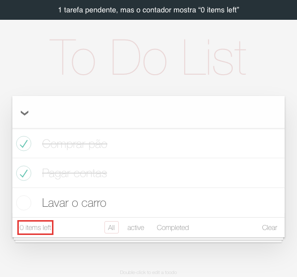 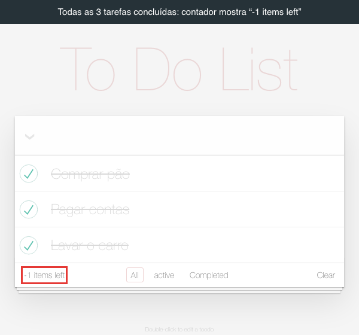

**Causa provável:** `js/controllers/todoCtrl.js:18` calcula `$filter('filter')(todos, { completed: false }).length -1`. A referência não tem o `-1`. Esse mesmo valor alimenta `completedCount` (BUG-13) e `allChecked` (BUG-02 e BUG-07).

**Teste:** `tests/test_contador_e_limpeza.py::test_contador_mostra_quantas_tarefas_estao_pendentes`

<a id="bug-02"></a>
### BUG-02 · “Mark all as complete” com 1 pendente reabre todas as tarefas

**Severidade:** Alta · **Prioridade:** Alta · **Reprodutibilidade:** sempre

**Passos**

1. Adicione “Comprar pão”, “Pagar contas” e “Lavar o carro”.
2. Conclua “Comprar pão” e “Pagar contas”. Repare que a seta à esquerda do campo (“Mark all as complete”) já aparece escura, como se estivesse marcada.
3. Clique na seta para concluir a última tarefa.

**Esperado:** as três tarefas ficam concluídas. Pela especificação, a caixa só fica marcada quando todas estão concluídas, e o clique deixa todas no estado dela.

**Obtido:** as três tarefas voltam a ficar pendentes. O usuário perde de uma vez o progresso que tinha marcado.

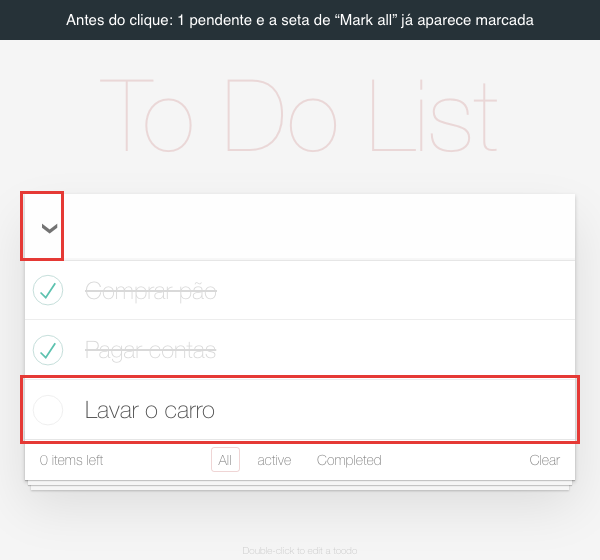 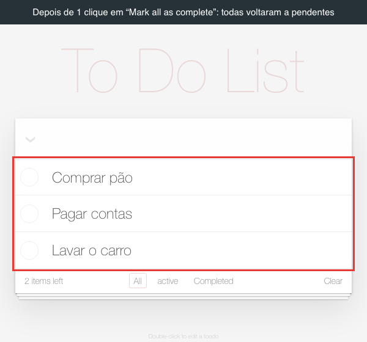

Animação do passo a passo: [evidencias/BUG-02.gif](evidencias/BUG-02.gif)

**Causa provável:** com 1 pendente, o contador errado do BUG-01 vale 0. Então `allChecked = !remainingCount` (`todoCtrl.js:20`) fica `true` e a caixa aparece marcada. O clique inverte para `false` e chama `markAll(false)`, que reabre tudo.

**Teste:** `tests/test_marcar_todas.py::test_marcar_todas_com_uma_pendente_conclui_todas` e `::test_caixa_fica_desmarcada_enquanto_houver_pendente`

<a id="bug-03"></a>
### BUG-03 · Com duas abas abertas, uma apaga as tarefas criadas na outra

**Severidade:** Alta · **Prioridade:** Média · **Reprodutibilidade:** sempre

**Passos**

1. Abra a aplicação em uma aba (aba 1).
2. Abra a mesma URL em outra aba do mesmo navegador (aba 2).
3. Na aba 1, adicione “Criada na aba 1”.
4. Na aba 2, adicione “Criada na aba 2”.
5. Recarregue a aba 1.

**Esperado:** as duas tarefas aparecem.

**Obtido:** só aparece “Criada na aba 2”. A tarefa criada na aba 1 foi apagada do armazenamento e não volta.

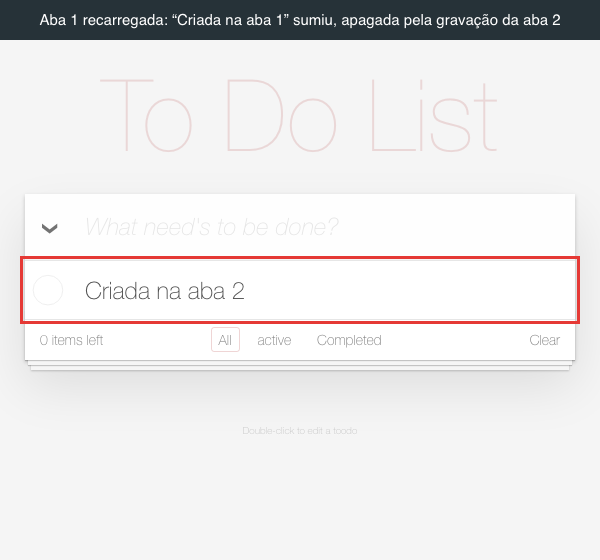

**Causa provável:** cada aba guarda a lista em memória e regrava a lista inteira a cada alteração (`todoStorage.js:103`). Ela não relê o `localStorage` antes de gravar e não escuta o evento `storage`.

**Teste:** `tests/test_persistencia.py::test_duas_abas_nao_apagam_as_tarefas_uma_da_outra`

<a id="bug-04"></a>
### BUG-04 · Com o armazenamento cheio, a tarefa não é salva e o campo trava

**Severidade:** Alta · **Prioridade:** Baixa (exige o armazenamento do site cheio) · **Reprodutibilidade:** sempre · **Navegador:** verificado só no Chrome (a cota do armazenamento muda de um navegador para outro)

**Passos**

1. Adicione “Já salva”.
2. Simule o armazenamento cheio. No console do DevTools, execute:
   ```js
   let n = 0; for (const t of [1 << 20, 1 << 16, 1 << 12, 1 << 8, 16, 1]) { const b = 'x'.repeat(t); try { while (true) localStorage.setItem('ocupado-' + n++, b); } catch (e) {} }
   ```
3. Adicione “Não cabe”.
4. Tente concluir “Já salva” e depois recarregue a página.

**Esperado:** a aplicação avisa que não conseguiu salvar e o campo continua utilizável.

**Obtido:** “Não cabe” aparece na lista, mas não foi salva. O campo fica desabilitado com o texto dentro e não volta a funcionar. O console mostra `QuotaExceededError: Failed to execute 'setItem' on 'Storage'`. A conclusão do passo 4 também não é salva, e depois de recarregar “Não cabe” desaparece. Nenhuma mensagem aparece para o usuário.

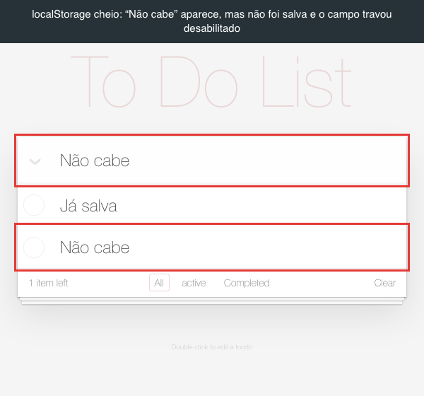

Para limpar depois do teste: `Object.keys(localStorage).filter(k => k.startsWith('ocupado-')).forEach(k => localStorage.removeItem(k))`.

**Causa provável:** `_saveToLocalStorage` (`todoStorage.js:103`) lança a exceção dentro de `insert`, antes de a promise existir. Assim, o `.finally` que faria `saving = false` (`todoCtrl.js:46-48`) nunca roda, e o `ng-disabled="saving"` mantém o campo desabilitado.

**Teste:** `tests/test_persistencia.py::test_armazenamento_cheio_nao_trava_o_campo`

<a id="bug-05"></a>
### BUG-05 · Com o armazenamento bloqueado ou com valor inválido, a aplicação fica em branco

**Severidade:** Alta · **Prioridade:** Média (bloquear dados de sites é uma configuração de privacidade comum) · **Reprodutibilidade:** sempre

**Passos (cenário A: armazenamento bloqueado)**

1. No Google Chrome, abra `chrome://settings/content/siteData` e escolha a opção que não permite aos sites salvar dados no dispositivo. Testei com a preferência equivalente do perfil, `profile.default_content_setting_values.cookies = 2`, no Chrome 156.
2. Abra a aplicação.

**Passos (cenário B: valor inválido)**

1. No console do DevTools, execute `localStorage.setItem('todos-angularjs', '{corrompido')`. Isso simula um dado gravado com defeito ou por outra versão do app.
2. Recarregue a página.

**Esperado:** a aplicação abre e funciona. No cenário A, ela avisa que as tarefas não serão guardadas. No cenário B, descarta o dado inválido e, de preferência, avisa o usuário.

**Obtido:** nos dois cenários, a página fica em branco, só com o fundo. O console mostra `SecurityError: Failed to read the 'localStorage' property from 'Window': Access is denied for this document.` no cenário A e `SyntaxError: Expected property name or '}' in JSON at position 1` no cenário B. No cenário B, o usuário comum só sai dessa situação limpando os dados do site.

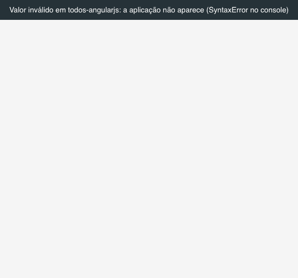

**Causa provável:** a leitura do armazenamento em `todoStorage.js:99` (`JSON.parse(localStorage.getItem(...))`) não tem tratamento de erro. A rota depende desse carregamento (`resolve` em `app.js:15-22`), então a tela nunca é montada.

**Teste:** `tests/test_persistencia.py::test_armazenamento_bloqueado_nao_deixa_a_tela_em_branco` e `::test_dado_invalido_no_armazenamento_nao_deixa_a_tela_em_branco`

<a id="bug-06"></a>
### BUG-06 · Campo de nova tarefa fica com 3 espaços depois de adicionar

**Severidade:** Média · **Prioridade:** Alta (acontece em toda tarefa adicionada) · **Reprodutibilidade:** sempre

**Passos**

1. Digite “Comprar pão” e pressione Enter.
2. Observe o campo e selecione o conteúdo dele (Ctrl/Cmd+A).
3. Digite “Pagar contas”.

**Esperado:** o campo fica vazio e o placeholder volta a aparecer. A especificação diz que o campo deve ser limpo.

**Obtido:** o campo fica com 3 espaços (`"   "`). O placeholder não volta, e o próximo texto começa 3 espaços deslocado (`"   Pagar contas"`). O título salvo sai sem os espaços, porque a aplicação apara o texto, então o problema é de interface.

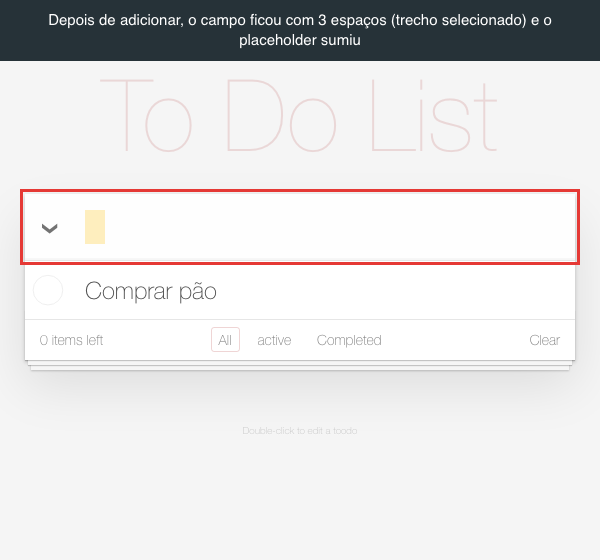

**Causa provável:** `todoCtrl.js:44` faz `$scope.newTodo = '   ';`. A referência usa `''`.

**Teste:** `tests/test_tarefas.py::test_campo_fica_vazio_depois_de_adicionar`

<a id="bug-07"></a>
### BUG-07 · Com todas concluídas, “Mark all” aparece desmarcado e exige 2 cliques

**Severidade:** Média · **Prioridade:** Média · **Reprodutibilidade:** sempre

**Passos**

1. Adicione “Comprar pão” e “Pagar contas”.
2. Clique na seta “Mark all as complete”. As duas ficam concluídas.
3. Observe a seta e clique nela uma vez.

**Esperado:** com tudo concluído, a seta fica marcada (escura), e um clique reabre todas as tarefas.

**Obtido:** a seta continua desmarcada (cinza-claro) com tudo concluído. O primeiro clique não muda nenhuma tarefa, e só o segundo reabre todas.

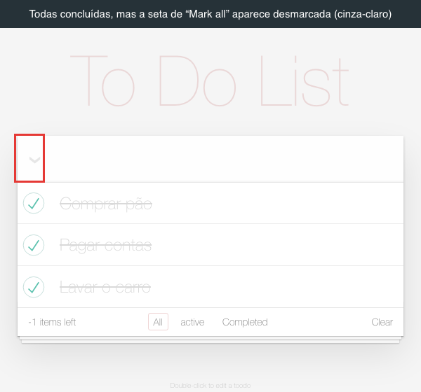

**Causa provável:** a mesma do BUG-01. Com zero pendentes, o contador vale -1, e `allChecked = !(-1)` resulta em `false`.

**Teste:** `tests/test_marcar_todas.py::test_caixa_fica_marcada_quando_todas_estao_concluidas` e `::test_um_clique_reabre_todas_quando_todas_estao_concluidas`

<a id="bug-08"></a>
### BUG-08 · Excluir e editar tarefas não funcionam pelo teclado

**Severidade:** Média (impede o uso para quem navega só pelo teclado) · **Prioridade:** Média · **Reprodutibilidade:** sempre

**Passos**

1. Adicione “Comprar pão”.
2. Usando só o teclado (Tab, Shift+Tab, Enter e Espaço), tente excluir e depois editar a tarefa.

**Esperado:** tudo o que se faz com o mouse também se faz pelo teclado (WCAG 2.1.1).

**Obtido:** o Tab passa por campo, “Mark all”, checkbox da tarefa, All, active, Completed e Clear. O botão excluir (×) nunca recebe foco, porque só existe na tela com o mouse sobre a tarefa. A edição só abre com duplo clique, e nenhuma tecla faz o mesmo.

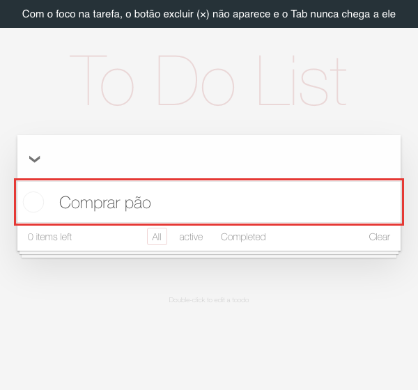

**Causa provável:** `.todo-list li .destroy { display: none }`, que só muda com `li:hover` (`todomvc-app-css/index.css:221` e `:244`). A edição está presa ao `ng-dblclick` do rótulo (`index.html`).

**Teste:** `tests/test_acessibilidade.py::test_botao_excluir_e_alcancavel_pelo_teclado`. A edição pelo teclado foi verificada manualmente.

<a id="bug-09"></a>
### BUG-09 · No celular, a página não se ajusta à tela e aparece reduzida

**Severidade:** Média · **Prioridade:** Média · **Reprodutibilidade:** sempre, em celular ou no modo dispositivo do DevTools

**Passos**

1. Abra a aplicação em um celular ou no modo dispositivo do DevTools (iPhone SE, 375×667).
2. Adicione duas tarefas e tente ler o rodapé.

**Esperado:** o layout se ajusta à largura da tela.

**Obtido:** a página é montada com cerca de 980 px de largura (`window.innerWidth` vale 981 no Chromium e 980 no WebKit, numa tela de 375 px) e reduzida para caber. O texto das tarefas fica com cerca de 9 px, o rodapé com cerca de 4 px, e os alvos de toque ficam pequenos.

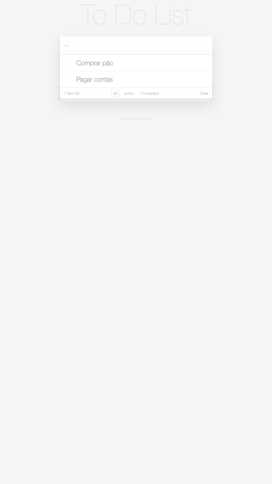

**Causa provável:** falta `<meta name="viewport" content="width=device-width, initial-scale=1">` no `<head>` do `index.html`.

**Teste:** `tests/test_acessibilidade.py::test_pagina_usa_a_largura_da_tela_do_celular` (Chromium e WebKit)

<a id="bug-10"></a>
### BUG-10 · AngularJS 1.4.3 sem suporte e com 14 vulnerabilidades conhecidas

**Severidade:** Média · **Prioridade:** Média · **Tipo:** análise de dependências

**Evidência**

- `angular.version.full` no console devolve `"1.4.3"` (o cabeçalho de `node_modules/angular/angular.js` confirma), e `angular-route` e `angular-resource` estão na mesma versão.
- O AngularJS saiu de suporte em 31/12/2021 e não recebe mais correções de segurança.
- `npm audit` sobre `angular@1.4.3` lista 14 alertas: 3 altos, 8 moderados e 3 baixos. Exemplos: poluição de protótipo em `angular.merge` ([GHSA-89mq-4x47-5v83](https://github.com/advisories/GHSA-89mq-4x47-5v83), corrigida na 1.7.9), XSS pelas funções de DOM do jqLite ([GHSA-5cp4-xmrw-59wf](https://github.com/advisories/GHSA-5cp4-xmrw-59wf), corrigida na 1.8.0) e ReDoS ([GHSA-4w4v-5hc9-xrr2](https://github.com/advisories/GHSA-4w4v-5hc9-xrr2), sem correção).

**Esperado:** dependências com suporte e sem vulnerabilidades conhecidas.

**Observação:** não consegui explorar nenhuma dessas falhas nesta tela. HTML e expressões do Angular digitados como tarefa aparecem como texto (CT-08 passou). O risco está na base desatualizada, que não recebe correções. A recomendação é migrar para um framework com suporte ou contratar suporte estendido.

<a id="bug-11"></a>
### BUG-11 · Indicador de foco do teclado foi removido

**Severidade:** Média · **Prioridade:** Baixa · **Reprodutibilidade:** sempre

**Passos**

1. Adicione “Comprar pão”.
2. Com o cursor no campo de nova tarefa, pressione Tab duas vezes. O foco vai para o checkbox da tarefa.

**Esperado:** um indicador visível mostra onde está o foco (WCAG 2.4.7).

**Obtido:** nada muda na tela. O foco também fica invisível nos links de filtro e no botão “Clear”.

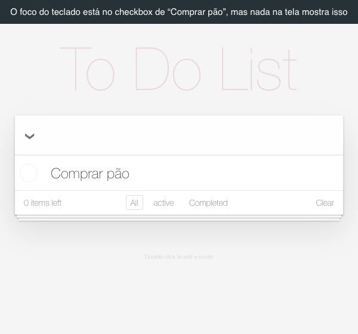

**Causa provável:** a folha de estilos remove o contorno de foco de todos os elementos (`:focus { outline: 0; }`, em `todomvc-app-css/index.css:36`), e o checkbox real tem `opacity: 0`.

**Teste:** `tests/test_acessibilidade.py::test_checkbox_focado_pelo_teclado_tem_indicador_visivel`. O teste compara um print da tarefa antes e depois do foco.

<a id="bug-12"></a>
### BUG-12 · Checkbox de cada tarefa não tem nome acessível

**Severidade:** Média · **Prioridade:** Baixa · **Reprodutibilidade:** sempre

**Evidência:** na árvore de acessibilidade (DevTools > Accessibility, ou o `aria_snapshot` do Playwright), cada tarefa aparece como `checkbox` sem nome. O axe-core acusa a regra `label` (impacto crítico: “Form elements must have labels”). Um leitor de tela anuncia só “caixa de seleção, não marcada”, sem dizer de qual tarefa. O nome acessível do botão excluir é apenas “×”.

**Esperado:** cada checkbox tem o título da tarefa como nome acessível (WCAG 1.3.1 e 4.1.2).

**Causa provável:** o `<input class="toggle">` e o `<label>` são irmãos, sem `for`/`id` nem `aria-label` (`index.html`).

**Teste:** `tests/test_acessibilidade.py::test_checkbox_da_tarefa_tem_nome_acessivel`

<a id="bug-13"></a>
### BUG-13 · Botão “Clear” aparece sem nenhuma tarefa concluída

**Severidade:** Baixa · **Prioridade:** Média · **Reprodutibilidade:** sempre

**Passos:** adicione “Comprar pão” e não conclua nada.

**Esperado:** o botão de limpar concluídas fica oculto enquanto não houver tarefa concluída (especificação).

**Obtido:** o botão “Clear” aparece, e o clique não faz nada.

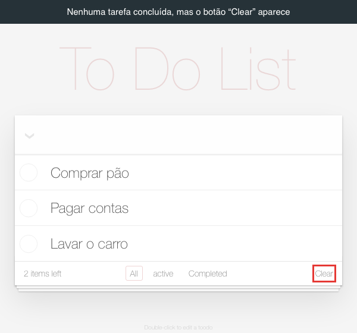

**Causa provável:** `completedCount = todos.length - remainingCount` (`todoCtrl.js:19`) usa o contador errado do BUG-01 e por isso vale pelo menos 1 sempre que há tarefas.

**Teste:** `tests/test_contador_e_limpeza.py::test_limpar_fica_oculto_sem_tarefas_concluidas`

<a id="bug-14"></a>
### BUG-14 · Tooltip do botão excluir mostra “TODO:REMOVE THIS EVENTUALLY”

**Severidade:** Baixa · **Prioridade:** Média (visível para todos, correção trivial) · **Reprodutibilidade:** sempre

**Passos:** adicione uma tarefa e deixe o mouse parado sobre o × por 1 a 2 segundos.

**Esperado:** nenhum tooltip, ou um tooltip útil, como “Delete”.

**Obtido:** aparece a anotação interna de desenvolvimento “TODO:REMOVE THIS EVENTUALLY”.

**Evidência:** `<button title="TODO:REMOVE THIS EVENTUALLY" class="destroy" ng-click="removeTodo(todo)">` no `index.html`. O tooltip nativo do sistema não sai em print automatizado.

**Teste:** `tests/test_textos.py::test_botao_excluir_nao_mostra_anotacao_interna`

<a id="bug-15"></a>
### BUG-15 · Comentário ofensivo no código-fonte público da página

**Severidade:** Baixa · **Prioridade:** Média (risco de imagem) · **Reprodutibilidade:** sempre

**Passos:** abra `view-source:https://todolist.james.am/` (Ctrl/Cmd+U).

**Obtido:** a linha 3 contém `<!-- THIS IS A STUPID APP AND I HAVE NO IDEA WHY WE'RE WASTING OUR TIME DOING THIS DEV WORK -->`.

**Esperado:** o código publicado não tem comentários internos nem depreciativos. O ideal é o build remover comentários.

**Teste:** `tests/test_textos.py::test_html_publico_sem_comentario_ofensivo`

<a id="bug-16"></a>
### BUG-16 · Placeholder com erro: “What need's to be done?”

**Severidade:** Baixa · **Prioridade:** Média (é o primeiro texto que o usuário lê) · **Reprodutibilidade:** sempre

**Obtido:** “What need's to be done?”. **Esperado:** “What needs to be done?”.

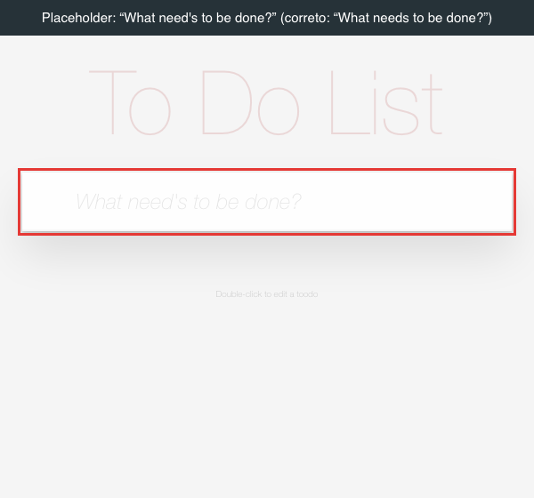

**Teste:** `tests/test_textos.py::test_placeholder_do_campo_de_nova_tarefa`

<a id="bug-17"></a>
### BUG-17 · Instrução do rodapé com erro: “toodo”

**Severidade:** Baixa · **Prioridade:** Baixa · **Reprodutibilidade:** sempre

**Obtido:** “Double-click to edit a toodo”. **Esperado:** “Double-click to edit a todo”.

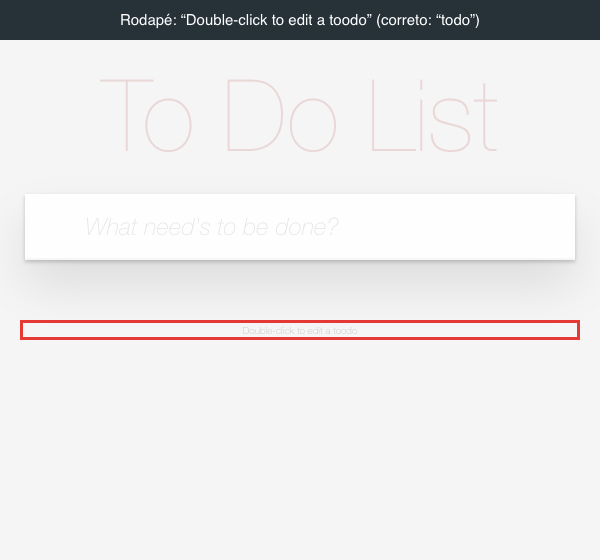

**Teste:** `tests/test_textos.py::test_instrucao_de_edicao_no_rodape`

<a id="bug-18"></a>
### BUG-18 · Filtro “active” em minúsculas, fora do padrão dos outros

**Severidade:** Baixa · **Prioridade:** Baixa · **Reprodutibilidade:** sempre

**Obtido:** filtros “All”, “active” e “Completed”. **Esperado:** “All”, “Active” e “Completed”.

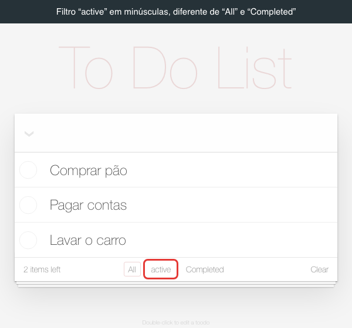

**Teste:** `tests/test_textos.py::test_nomes_dos_filtros_seguem_o_mesmo_padrao`

<a id="bug-19"></a>
### BUG-19 · Botão diz só “Clear” em vez de “Clear completed”

**Severidade:** Baixa · **Prioridade:** Baixa · **Reprodutibilidade:** sempre

**Obtido:** o botão diz “Clear”, o que sugere limpar a lista inteira. **Esperado:** “Clear completed”, como na especificação, deixando claro que só as concluídas serão removidas.

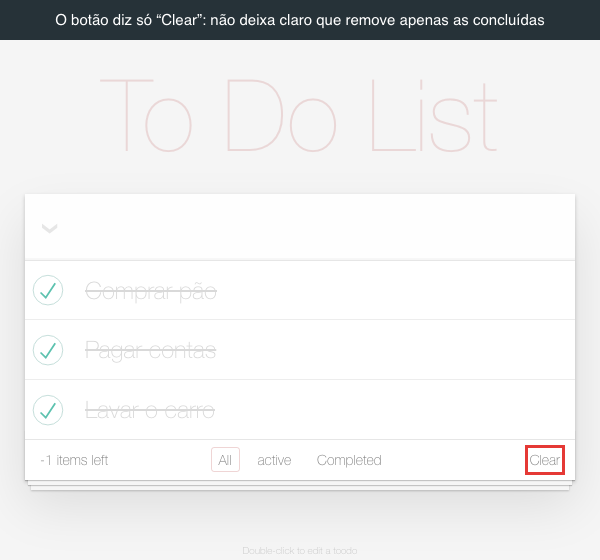

**Teste:** `tests/test_contador_e_limpeza.py::test_botao_de_limpar_diz_clear_completed`

<a id="bug-20"></a>
### BUG-20 · Rota inexistente mostra tudo sem nenhum filtro destacado

**Severidade:** Baixa · **Prioridade:** Baixa · **Reprodutibilidade:** sempre

**Passos:** com tarefas na lista, abra `https://todolist.james.am/#/xyz`. O mesmo acontece com `#/Active`, com A maiúsculo.

**Esperado:** voltar para `#/` com “All” destacado. É o que a própria configuração pretende com `.otherwise({ redirectTo: '/' })`.

**Obtido:** a URL continua `#/xyz`, a lista mostra todas as tarefas e nenhum filtro fica destacado.

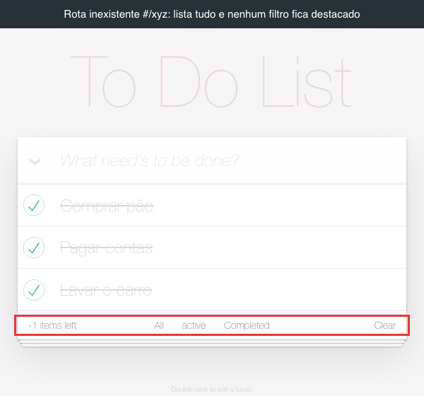

**Causa provável:** a rota `.when('/:status', ...)` (`app.js:28`) aceita qualquer valor, então o `otherwise` nunca é usado. Valores desconhecidos caem no filtro “todas” (`todoCtrl.js:26-28`).

**Teste:** `tests/test_filtros.py::test_rota_inexistente_volta_para_todas`

<a id="bug-21"></a>
### BUG-21 · Contraste de cor insuficiente em título, filtros e rodapé

**Severidade:** Baixa · **Prioridade:** Baixa · **Tipo:** acessibilidade (WCAG 1.4.3)

**Evidência:** o axe-core 4.10.2 acusa a regra `color-contrast` (impacto sério). Os links de filtro e o botão “Clear” têm contraste de 4,47:1 (#777 sobre branco), e o mínimo é 4,5:1. O título “To Do List” tem 1,26:1 (#ebd7d7 sobre #f5f5f5), e o mínimo para texto grande é 3:1. Pelas cores da folha de estilos, também ficam abaixo do mínimo o texto do rodapé (#bfbfbf sobre #f5f5f5, cerca de 1,7:1, em 10 px) e o placeholder (#e6e6e6 sobre branco, cerca de 1,25:1).

**Esperado:** contraste mínimo de 4,5:1 para texto normal e de 3:1 para texto grande.

**Teste:** manual, com axe-core e cálculo de contraste.

<a id="bug-22"></a>
### BUG-22 · Sem cabeçalhos de segurança: a página aceita ser embutida em outro site

**Severidade:** Baixa (a aplicação não tem login nem dados sensíveis no servidor) · **Prioridade:** Baixa

**Evidência:** a resposta de `GET /` não traz `Content-Security-Policy`, `X-Frame-Options`, `Strict-Transport-Security`, `X-Content-Type-Options` nem `Referrer-Policy`. Carreguei a aplicação dentro de um `<iframe>` numa página de outra origem, e ela funcionou normalmente. Isso abre espaço para clickjacking, em que outro site sobrepõe a aplicação para induzir cliques. HTTP redireciona para HTTPS (301), o que está correto.

**Esperado:** pelo menos `X-Frame-Options: DENY` ou CSP com `frame-ancestors 'none'`, mais HSTS e `nosniff`.

**Teste:** `tests/test_servidor_e_console.py::test_pagina_nao_pode_ser_embutida_em_iframe_de_outro_site`

<a id="bug-23"></a>
### BUG-23 · Duas requisições com erro 404 a cada carregamento

**Severidade:** Baixa · **Prioridade:** Baixa · **Reprodutibilidade:** sempre

**Passos:** abra o DevTools nas abas Console e Network e recarregue a página.

**Obtido:** `GET /learn.json` retorna 404. Quem pede esse arquivo é `todomvc-common/base.js`, que procura a barra lateral do projeto TodoMVC. `GET /api` também retorna 404: `todoStorage.js:16` procura um backend. Os dois aparecem como erro vermelho no console do Chrome e do WebKit a cada carregamento.

**Esperado:** console limpo. Erros esperados poluem o monitoramento e escondem erros reais. A detecção do backend deveria vir de configuração, e o script da barra lateral não deveria estar no produto.

**Teste:** `tests/test_servidor_e_console.py::test_carregamento_sem_erros_de_rede`

<a id="bug-24"></a>
### BUG-24 · Caractere invisível (largura zero) cria tarefa sem texto

**Severidade:** Baixa · **Prioridade:** Baixa · **Reprodutibilidade:** sempre

**Passos**

1. No console do DevTools, execute `copy('\u200b')`. Isso copia o caractere U+200B (espaço de largura zero), comum em texto copiado de páginas da web.
2. Cole no campo de nova tarefa e pressione Enter.

**Esperado:** nenhuma tarefa é criada, como acontece com um campo vazio ou só com espaços.

**Obtido:** é criada uma tarefa sem texto visível, salva como `{"title":"\u200b"}` e contada como pendente. Espaço não separável (U+00A0), tabulação e espaço ideográfico (U+3000) são ignorados corretamente.

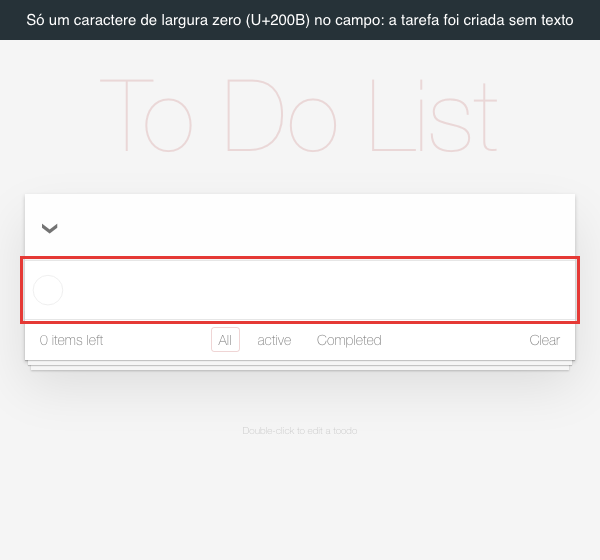

**Causa provável:** `todoCtrl.js:33` só usa `.trim()`, e o U+200B não é considerado espaço em branco pelo Unicode, então sobrevive ao `trim()`.

**Teste:** `tests/test_tarefas.py::test_caractere_invisivel_nao_cria_tarefa`

<a id="bug-25"></a>
### BUG-25 · O bucket que hospeda o site permite listar os arquivos publicamente

**Severidade:** Baixa · **Prioridade:** Baixa · **Tipo:** configuração de hospedagem

**Evidência:** os cabeçalhos `x-goog-*` mostram que o site é servido por um bucket do Google Cloud Storage. Abrir `https://storage.googleapis.com/todolist.james.am/` sem login devolve um `ListBucketResult` com os 12 arquivos publicados (`index.html`, `js/...` e `node_modules/...`). A API JSON (`storage/v1/b/todolist.james.am/o`) também responde 200.

**Esperado:** o público consegue ler os arquivos do site, mas não listar o conteúdo do bucket.

**Impacto:** hoje a listagem só mostra arquivos que já são públicos. Mas qualquer arquivo enviado por engano, como um backup, um `.env` ou um source map, ficaria fácil de descobrir.

**Sugestão:** dar ao público só a permissão de leitura de objetos (por exemplo, `roles/storage.legacyObjectReader`), sem `storage.objects.list`.

**Teste:** `tests/test_servidor_e_console.py::test_bucket_de_hospedagem_nao_lista_os_arquivos`

## 5. Observações de código sem efeito visível hoje

Encontrei estes pontos na comparação com a implementação de referência. Não causam falha visível hoje, mas vale corrigir junto com os bugs acima.

| ID | Onde | Observação |
|---|---|---|
| OBS-01 | `todoCtrl.js:120-122` | A condição `if (todo.completed !== completed)` de `markAll` foi comentada. Cada clique em “Mark all” regrava todas as tarefas, inclusive as que já estão no estado certo. Com o backend `/api`, isso viraria uma requisição PUT por tarefa. |
| OBS-02 | `index.html`, campo `.edit` | O atributo `ng-trim="false"` da referência foi removido. Não encontrei efeito visível, porque o título é aparado ao salvar, mas é uma divergência sem motivo aparente. |
| OBS-03 | `todoCtrl.js:80` e `todoStorage.js:155` | `saveEdits` chama `store.put(todo)` sem índice. No `localStorage`, isso executa `store.todos[undefined] = todo` e cria uma propriedade `"undefined"` no array. O `JSON.stringify` ignora essa propriedade, então hoje o efeito é nulo. A referência tem o mesmo defeito. |

## 6. O que funcionou

Estes comportamentos estão de acordo com a especificação nos três navegadores. A lista completa está em [casos de teste](casos-de-teste.md).

- Criar tarefa com Enter, aparar os espaços das pontas e ignorar entrada vazia ou só com espaços.
- HTML e expressões do Angular digitados como tarefa (``, `{{7*7}}`) aparecem como texto, sem executar nada.
- Acentos e emoji aparecem corretamente, e textos longos sem espaço quebram a linha sem criar rolagem horizontal.
- Concluir e reabrir tarefa; botão excluir no hover; tocar na tarefa no celular mostra o botão excluir.
- Edição: duplo clique abre o campo com foco; Enter e sair do campo salvam; Esc descarta; texto vazio exclui a tarefa.
- Filtros “All”, “active” e “Completed” mostram as tarefas certas, destacam o filtro e continuam aplicados depois de recarregar.
- Tarefas e estados continuam lá depois de recarregar a página.
- Campo de nova tarefa recebe foco ao abrir; lista e rodapé ficam ocultos sem tarefas; HTTP redireciona para HTTPS.
- Voltar e avançar do navegador acompanham o filtro; editar digitando tecla a tecla mantém os espaços do meio.
- Em janela de 320 px no desktop, não há rolagem horizontal. Com 1.000 tarefas, a lista carrega em cerca de 0,3 s e concluir, adicionar ou marcar todas leva até 0,2 s (Chromium, máquina local).
- Não há arquivos sensíveis expostos no domínio (`.git`, `package.json`): todos respondem 404.

**Limitações:** não testei Safari e Chrome em aparelhos reais (usei o motor WebKit e a emulação de celular do Chromium) nem leitores de tela reais (usei a árvore de acessibilidade e o axe-core). O modo com backend (`/api`) não existe neste ambiente, então não foi testado. O duplo toque para editar no celular funcionou na emulação do Chromium; na emulação do WebKit, a ferramenta não consegue tocar no elemento, então falta confirmar num iPhone real.
